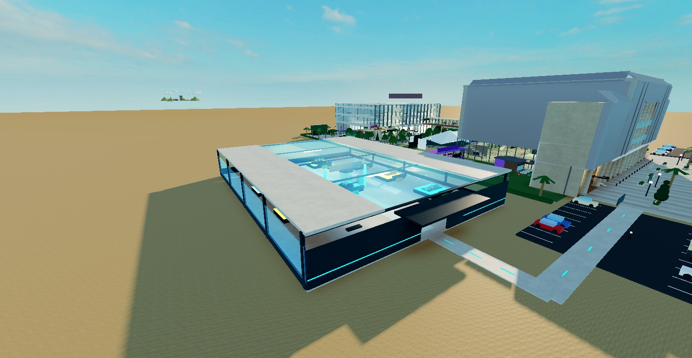
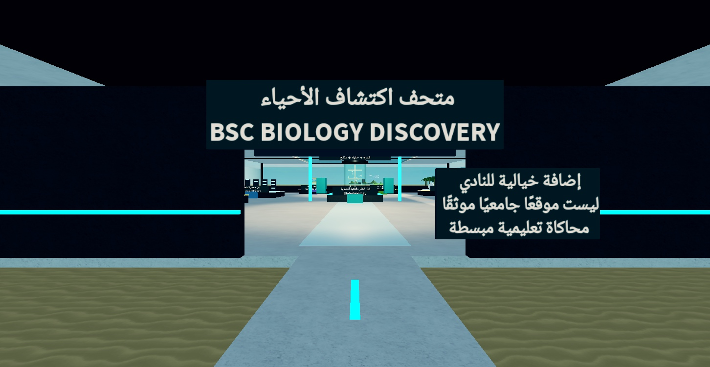
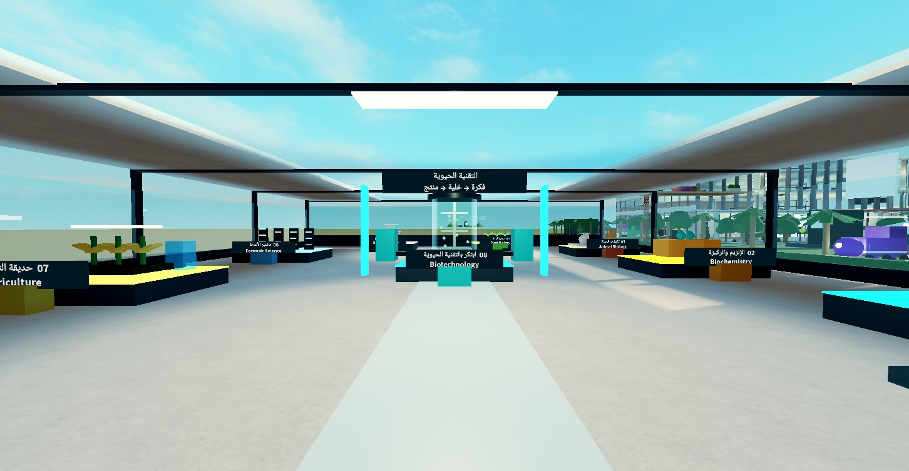
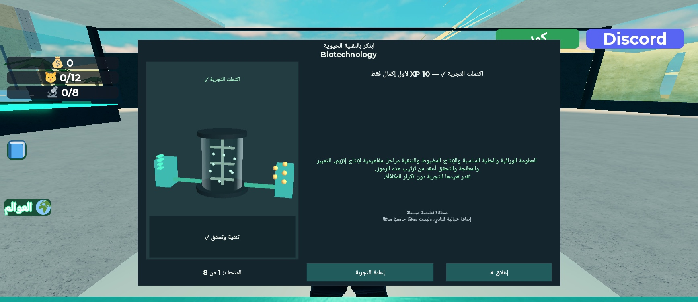
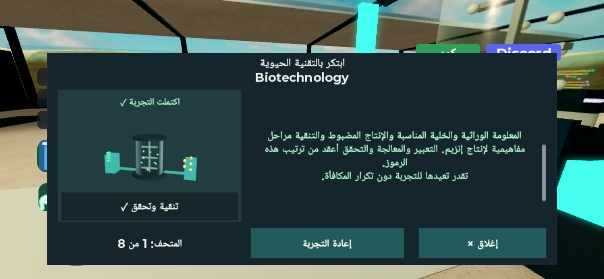

# BSC Biology Discovery Museum v46

2026-10-19، فرع `dev/v46` من `07a3cb4` بعد قبول المشرف v45. نسخة احتياطية كاملة قبل التعديل:
`Desktop/KuwaitParkour/backup_before_v46_20261019`، تشمل بناء v45. لا نشر أو دمج.

## ما أُنجز

جناح خيالي مستقل شرق الجامعة، بممر مضاء من الساحة الأمامية يلتف حول المواقف والمحطة. الموقع ليس غرفة جامعية حقيقية؛ توجد لوحة واضحة عند المدخل بذلك. لم تُنقل بوابة ولم يتغير الشمالي أو الجنوبي.

المتحف ثماني محطات قابلة للإكمال والإعادة، مع نموذج ثلاثي الأبعاد خاص بكل لاعب، وخيارات تركيب، وشرح للخطأ والنتيجة:

| التخصص | التفاعل وتغير النموذج |
|---|---|
| Microbiology | نقل العصية والخميرة والبراميسيوم إلى صواني التصنيف باستعمال دلائل الخلية |
| Biochemistry | تركيب اللاكتوز في الموقع، ثم فصل الجلوكوز والجالاكتوز إلى وعاء التجميع |
| Animal Biology | تركيب أذني الفنك والعزل الفروي والدهني للدب في نموذجي البيئتين |
| Plant Biology | توصيل الماء وCO₂، ثم مصدر الطاقة الضوئية، ثم السكريات والأكسجين |
| Molecular Biology | تركيب أربعة مواضع متكاملة وإظهار 3′ TACG 5′ مقابل 5′ ATGC 3′ |
| Forensic Science | تمييز نمط A في الأشرطة الخيالية وتحديد حدود الاستنتاج |
| Agriculture | ضبط الماء والضوء المناسبين للنموذج ومشاهدة نمو السيقان والأوراق |
| Biotechnology | تعليمات وراثية ثم خلية مناسبة ثم تشغيل المفاعل ثم فصل المنتج والتحقق؛ جناح مركزي أكبر بصريًا |

التفاعلات تُقاد بأزرار تركيب متتابعة مع تغيّر النموذج، وليست محاكاة مختبرية واقعية أو سحبًا حرًا للمجسمات.
كل معروضة تمنح 10 XP مرة واحدة، بالتساوي بين التخصصات. إكمال الثمانية يفتح لقب «دليل الاكتشاف» عبر الجواز الحالي.
لا تغيير للكوينز أو البحث أو التحديات الأسبوعية السابقة. أختام `museum:<id>` تستعمل دمج وحفظ الجواز القائم.

السيرفر يتحقق من المعروضة والمسافة والحياة والشخصية ومرحلة الجلسة وtoken والوقت. تُرفض الجلسة القديمة بعد السفر عبر `TeleportRevision`، وتُنظف عند الموت أو الابتعاد. اللاعب لا يرسل XP أو اكتمالًا مصدقًا ذاتيًا.

## اختبارات نُفذت

| الاختبار | النتيجة |
|---|---|
| Solo — الثمانية | أُكملت من الواجهة الفعلية؛ اختيار خاطئ في كل خطوة ثم تصحيح، وإعادة دون تكرار XP؛ 80 XP ولقب الجميع |
| نماذج نهائية | فُحصت تغيّرات التجميع بعد المراجعة؛ كُشف دوران المفاعل وصُحح بالحفاظ على اتجاه الـPivot أثناء التوسيط |
| الهاتف | iPhone XR أفقي 801×413؛ الثمانية تعمل، جميع TextFits ناجحة. تنبيه الخطأ يبقى فوق النموذج؛ النتيجة تُمرر تلقائيًا؛ إعادة وإغلاق بضغط فعلي ناجحان |
| عميلان فعليان | StudioTestService بسيرفر وعميلين: الأول ثماني معروضات و80 XP، الثاني معروضة واحدة و10 XP؛ لا تسرب تقدم أو لقب، ورفض إعادة token. مدد وقواعد المتحف عادية |
| الطلبات المزورة | رفض token مزور، نوع اختيار غير صالح، رقم خطوة قديم، تفاعل بعيد، وإعادة الجلسة المكتملة |
| الموت | بدأ نموذج الميكروبات وتقدم خطوة، مات وعاد بعد respawn؛ رُفض token القديم وبقي XP صفرًا |
| السفر | بدأ وتقدم ثم انتقل عبر Travel إلى HQ وعاد؛ رُفض token القديم وبقي XP صفرًا |
| المشي | من الممر الخارجي إلى المدخل، الممرين الجانبيين والجناح الخلفي، ثم الخروج والعودة للساحة؛ صحة 100، دون سقوط. استُعمل Humanoid عند مستوى الأرض بعد أن اختارت أداة الملاحة الآلية السطح |
| الحواجز والكاميرا | فحص حجم الموقع والممر قبل البناء دون عوائق قديمة؛ أشعة ممرات رئيسية بلا حواجز؛ ثلاث زوايا خارجية/مدخل/داخلية وصور الواجهة بعد التصحيح |
| الوجهات الـ12 | انتقالات فعلية، مع احترام مهلة البوابة؛ وصلت نقاط الظهور الصحيحة، والباركور عند المرحلة صفر في الملف الجديد. مسافات أفقية صفر |
| القواعد والبيانات | Lune: المعروضات الثماني، الخطأ والإعادة، المدخلات غير الصالحة، دمج الأختام ومنع التكرار؛ اختبارات Passport v45 القديمة ناجحة |
| المشروع | StyLua check ناجح؛ selene صفر أخطاء وصفر parse errors و26 تحذيرًا معروفًا؛ بنوك الأسئلة: 48/8، و80، و5 مولدات ×400 سحب؛ Rojo build ناجح |

نتيجة العميلين في [v46/multiplayer-results.json](v46/multiplayer-results.json)، والمصدر المؤقت خارج `src` في `tools/studio_tests/museum46.*.luau`. نُزعت سكربتات QA من Studio بعد الاختبار.

المراجعة المستقلة كشفت نقص تغيّر بعض النماذج وبقاء الجلسات بعد المغادرة؛ أُصلحت الحالتان وأُعيدت مراجعتهما واختبارهما. لا أخطاء جديدة من سكربتات اللعبة؛ بقيت رسائل DataStore غير المنشور وUIBlox والأصل 203785492 المعروفة.

## الهندسة والأداء والمراجعة العلمية

- إضافة 216 قطعة، منها 58 قابلة للتصادم، و261 عنصرًا تابعًا للجناح. العدد الكلي لمصادر السكربت 71 مقابل 66 في v45.
- مقارنة XML تؤكد أن **Workspace القديم كاملًا مطابق لـv45** بعد استثناء الإضافة Museum46؛ يشمل هذا الشمالي والجنوبي والجزيرة والأنظمة الأخرى. بقي StreamingEnabled معطلًا.
- نحو 60 FPS بعينة قصيرة على هذا الكمبيوتر قرب المتحف؛ ليس قياس أداء هاتف حقيقي أو ضغط سيرفر طويل.
- العرض الثلاثي الأبعاد في جلسة Studio القديمة أصبح أسود حتى للنماذج السابقة. جلسة جديدة لبناء v46 أعادت العرض الطبيعي؛ أُخذت الصور والفحوص البصرية منها. بقيت النافذة الأصلية مفتوحة.
- أُرسل المحتوى لـGemini لكن لم يصل رد مراجعة صالح. وافق المشرف على مراجعة بديلة للنصوص، وطُبّقت ملاحظاته. تفاصيل المصادر والحدود في [museum_v46_science.md](museum_v46_science.md).

## الصور والبناء

البناء المحلي `C:/Users/User/Desktop/KuwaitParkour/KuwaitParkour_v46.rbxlx`، 37,774,929 بايت.
SHA256: `a023a406a47b7a7db462fa736488282bbd1c8da6e741d111ea6376ff459397d1`.

الحدود: لا حفظ دائم منشور، ولا هاتف حقيقي، ولا جلسة بشرية طويلة، ولا اعتماد مؤسسي للمحتوى أو مطابقة واقعية للمتحف الخيالي.
الجاهزية تطويرية وفق الاختبارات المذكورة؛ يرسل التقرير للمشرف قبل اختيار v47. لا نشر أو دمج.
