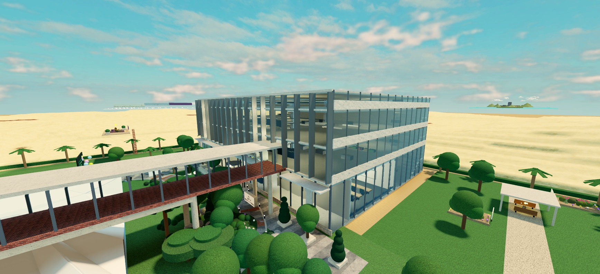
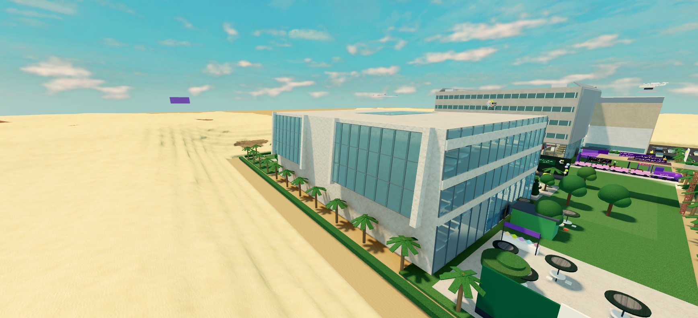
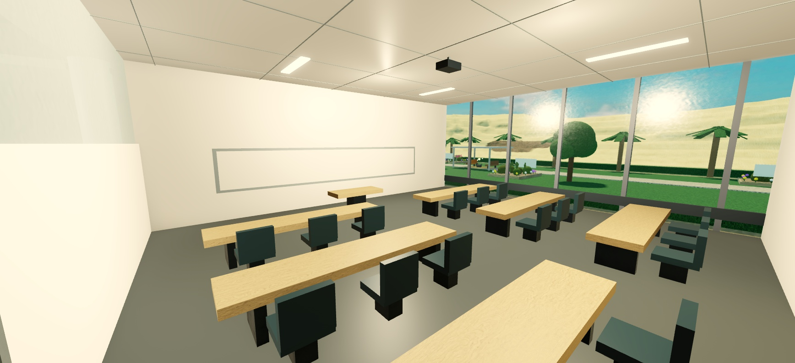
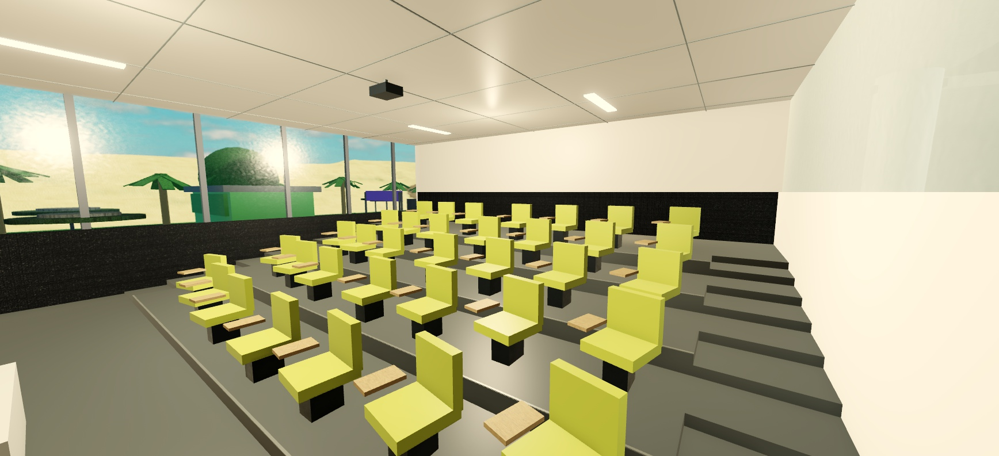
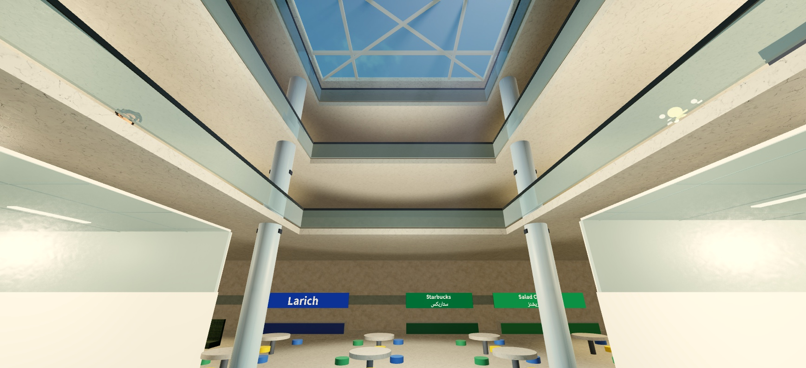
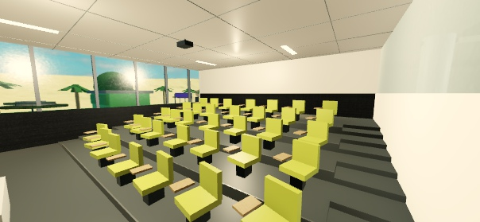

# الشمالي v44 — نسخة تطويرية قابلة للعب

2026-10-19 — فرع `dev/v44`، مبني على `dev/v43`. تفويض الإمبراطور يسمح بالنموذج التطويري فقط.
لم تُنشر اللعبة ولم يُدمج الفرع. النسخة الاحتياطية السابقة للتعديل: `Desktop/KuwaitParkour/backup_before_v44_20261019`.

## النتيجة وحدود الدقة

مبنى شمالي بأربع مناسيب موروثة، بهو مضاء بسقف زجاجي، واجهات وأعمدة، قاعة مستوية ومدرج مختلف عنها فعليًا،
وممرات إلى السلالم والحديقة والممر الأحمر. النموذج مستوحى من الواقع؛ ليس إعادة بناء مساحية أو مخطط غرف معتمدًا.
تعرض لوحة الدخول أن التوزيع الداخلي تقديري. لا أرقام غرف جديدة، ولا مصاعد أو مواقع جديدة للنادي أو السلالم.

| التصنيف | ما استُخدم | ما لا يثبته المصدر |
|---|---|---|
| A: ظاهر بالمراجع | الصورة17: طاولات طويلة فاتحة، كراسٍ داكنة، قاعة مستوية، سبورة ونوافذ جانبية. الصورة16: صفوف خضراء منحنية، مصاطب وممر جانبي، محاضر في الأسفل | أبعاد الغرف، أعداد المقاعد، مواقع القاعات داخل المبنى |
| A: ظاهر بالمراجع | الزجاج المائل والإطار الحجري في الصورة1؛ البهو متعدد المناسيب والأعمدة المعدنية والدرابزين الزجاجي والسقف الشبكي في الصور2 و8 و9 و15 | اتجاه الواجهة الحقيقي أو توزيع عناصر الحركة الرأسية |
| B: تفسير بصري | درجات الحجر والزجاج، تبسيط الأسقف والأثاث والنسب لكي تناسب Roblox | نوع المادة الحقيقي أو قياسها الهندسي |
| C: تقدير للعبة | حدود x=-80..100 وz=130..260، مناسيب0/24/40/56، سقف64؛ موضعا القاعتين في الأرضي، أعدادهما18 و35 مقعدًا، تخطيط البهو والواجهات، مواقع السلالم الموروثة | أي تطابق مع أرقام أو مواقع غرف أو سلالم أو مصاعد حقيقية |

المصدر المرئي الرئيسي: [منشور SSUC، كلية العلوم — الحرم الشمالي، 2024-11-10](https://www.instagram.com/p/DCOOAtEtLBF/?img_index=17).
راجعت صور المنشور الـ17 بصريًا في المتصفح؛ لم تُنسخ الصور الأصلية إلى Git. قُرئت الدراسة السابقة ولقطاتها المنتقاة من
فيديوهات TikTok؛ مشاهدة الفيديوهات السابقة كانت جزئية ولا أدّعي مراجعة كل ثانية منها. لا تُعامل خرائط الجنوبي أو
kuwaitservices كمخطط شمالي موثّق.

## التصميم القابل للتعديل

المصدر: `tools/north_campus44.py`، يستدعيه `tools/genmap9.py` مكان مولّد الشمالي القديم فقط.
داخل `Campus/NorthBuilding` سبع وحدات: `Envelope`, `Floors`, `Atrium`, `Circulation`,
`FlatClassroom_Photo17`, `TieredLecture_Photo16`, `ExistingAmenities`.
تحتوي الوحدات على `Evidence` يميز المظهر المرجعي عن `placement=C`. حدود القاعات والمناسيب معرّفة في بداية الملف؛
يمكن تغيير القاعات أو الغلاف دون تغيير سكربتات اللعب. يحتفظ المولّد باستهلاك RNG القديم لمنع تغير بقية العالم.

احتُفظ بالمقاهي والألعاب والجلسات وعروض الحاسوب الموجودة. بعض أثاث الشمالي وُزع على أرضيات صلبة حول البهو الجديد؛
هذه أماكن للعبة وليست توثيقًا لمرافق الجامعة. لم يُنقل مقر النادي أو القط المقتنى أو أي بوابة.

### التعديل الضروري الوحيد في الجنوبي

كشف اختبار المشي أن الكسوة القديمة تغلق طرف الممر الأحمر عند z=-30. بعد توضيح السبب للإمبراطور، فُتحت مساحة
x=-50..-30 وy=24..36 فقط عند الاتصال الحالي، وقُسم شريط الزجاج وقطعه الزخرفية عند الفتحة نفسها.
لم يتغير داخل الجنوبي أو سلالمه أو بقية واجهاته. هذه فتحة اتصال تطويرية C؛ لا نزعم أنها باب حقيقي موثّق.
التعديل المحدد في `tools/genmap5.py` و`tools/campus9.py`؛ يتحقق المدقق من هذه الاستثناءات بالضبط.

## ما اختُبر فعليًا في Studio

أُعيد تشغيل Studio بتفويض الإمبراطور لأن قائمة MCP كانت بلا اتصال. فُتح بناءv43 محليًا دون تسجيل دخول جديد،
ثم حُمّلت الهندسة الجديدة في Edit. اسم تبويب Studio يبقى `KuwaitParkour_v43.rbxlx` ومحتواه الحالي هندسةv44.
لم يُغلق Studio. الاختبارات Solo Play، لاعب R15 واحد؛ `Humanoid:MoveTo` حقيقي مع تعطيل القفز أثناء مسارات المشي،
ونقل ابتدائي للشخصية عند بدء كل اختبار. أدوات الفحص مؤقتة ولم تُضف كسكربتات إلى المشروع.

| الفحص | النتيجة |
|---|---|
| القاعة المستوية، مدخل المدرج، ممره الغربي صعودًا، خلف المقاعد، ممره الشرقي نزولًا والعودة | 19 نقطة مشي نجحت دون قفز أو جلوس عرضي |
| الجنوبي ↔ الحديقة الشرقية ↔ الشمالي | 20 نقطة نجحت |
| الحديقة الغربية ↔ الشمالي | 23 نقطة نجحت في الاتجاهين |
| السلم الغربي صعودًا إلى56 ثم الشرقي نزولًا، والعكس | 25 نقطة لكل دورة نجحت، مع الوصول لمناسيب24 و40 و56 والأرضي دون قفز |
| الممر الأحمر من الشمالي إلى داخل الجنوبي والعودة | 10 نقاط نجحت بعد فتح الاتصال القديم المغلق |
| حواف فتحة البهو الأربع على24 و40 و56 | 12 محاولة مشي نحو الفراغ؛ الحواجز أوقفت اللاعب ولم يسقط |
| مقعد حقيقي في كل نموذج | نجح الجلوس والقيام في النموذجين؛ مجموع المقاعد53 |
| كاميرا اللعب العادية في مداخل وزوايا القاعتين وخلف المدرج وشرفة البهو | 5 مواضع؛ حجم فحص0.3ستد حول الكاميرا لم يتداخل مع جسم متصادم |
| الانتقال إلى الوجهات الـ12 عبر RemoteEvent الحالي Travel | نجحت كلها؛ المسافة الأفقية إلى spawn المتوقع0. لم يُعد اختبار ضغط بطاقات القائمة فيv44؛ نجح سابقًا فيv43 |
| المرحلة والكوينز أثناء فحص الانتقال | بقيت0؛ لم يتغير أي مصدر سكربت حفظ أو مكافأة |
| بداية Play جديدة نهائية | لا أخطاء جديدة من سكربتات اللعبة. بقيت تحذيرات DataStore لملف غير منشور، وتحذير UIBlox، ورسائل الأصل203785492 المعروفة |

أُصلحت أثناء QA: تصادم لوحات الطوابق عند نزول السلم؛ فتحة سقف قديمة كان يضيفها hook إلى السقف الجديد؛
انكشاف عشب الحديقة خلال أرضية القاعة؛ وإضاءة ضعيفة ولافتة كانت تحجب منظر البهو.
صحّحت أيضًا نقاط اختبار كانت تقطع مكتب المحاضر أو تستخدم اتجاهًا معكوسًا للسلم؛ هذه أخطاء مسار الفحص، وليست تغييرات لعب.

## الأداء والتحقق من عدم التراجع

- الشمالي: **863 BaseParts، 951 descendants، 53 Seat، 18 PointLight دون ظلال**؛ السابق756 قطعة، الصافي **+107 (+14.2% للشمالي)**.
- إجمالي الخريطة المولدة25941 قطعة، وMap في جلسة Play النهائية27987 descendants. عدد القطع ليس عدد كل أنواع Instances.
- اللقطات الثلاث التالية180 إطارًا لكل منظر، Solo Studio على هذا الكمبيوتر، viewport1736×793:

| المنظر | متوسط FPS | median ms | p95 ms | أقصى ms |
|---|---:|---:|---:|---:|
| الخارج من جهة الحديقة | 59.97 | 16.68 | 18.11 | 18.62 |
| المدرج | 60.02 | 16.56 | 17.95 | 18.50 |
| البهو من المدخل | 60.00 | 16.71 | 18.19 | 18.77 |

- ذاكرة Stats في لقطة الخارج نحو3080MB للجلسة كاملة؛ ليست ذاكرة الشمالي وحده ولا مقارنة قبل/بعد.
- محاكي iPhone XR أفقي801×413: راجعت المدرج بصريًا؛ متوسط59.97FPS وp95=18.29ms. المحاكي يعمل على الكمبيوتر،
  **لا يثبت أداء هاتف حقيقي**. أُعيد Studio للمنفذ الافتراضي بعد الفحص.
- `validate_north44.py` نجح: جميع جذور العوالم الأخرى والحديقة والمقتنيات والبوابات والـcheckpoints مطابقة لـv43؛
  الجنوبي مطابق باستثناء فتحة الاتصال المحددة. يتحقق أيضًا من مساحة السقف الصحيحة وعدم تصادم لوحات الطوابق وميزانية القطع.
- المولّد: 0 مخالفات مسار، 0 clashes. StyLua check ناجح. Selene: **0 errors، 0 parse errors، 27 warnings معروفة**
  (يُرجع exit1 بسبب التحذيرات، فلا توصف النتيجة بأنها خالية من التحذيرات).
- بنوك الأسئلة:48 سؤالًا في8بنوك، ومركز التحديات80سؤالًا و5مولدات×400سحب، كلها نجحت.
- مقارنة XML لبناءv44 معv43: **مصادر السكربتات الـ63 متطابقة**. مراجعة مستقلة للكود؛ ملاحظة السقف أُصلحت وأُعيد التحقق منها.
- `StreamingEnabled=false` باقٍ، ولم تُغيّر إعداداته.

## الصور والبناء

لقطات Play أصلية، دون معالجة أو صور مولدة:

البناء المحلي: `C:/Users/User/Desktop/KuwaitParkour/KuwaitParkour_v44.rbxlx`، 37,399,642بايت؛ لا يُرفع إلىGit.
SHA256: `2260ba05fff0ae3902e459425b4ad7677dc11cf42ff582530c0ef0ef465ed7f4`.
إعادة البناء من جذر المشروع: `python tools/genmap9.py` ثم
`tools/rojo/rojo.exe build kuwait-parkour/default.project.json -o C:/Users/User/Desktop/KuwaitParkour/KuwaitParkour_v44.rbxlx`.
لا يلزم توليد الجزيرة بـLune لأنها لم تتغير.

## ما لم يُختبر وما يلي

لم تُختبر جلسة بشرية متعددة اللاعبين، أو هاتف فعلي، أو حفظ سحابي منشور. لم تُعد جميع ألعاب الأركيد والباركور
اختبارًا تفصيليًا؛ مصادرها وهندستها مطابقة، وفحص الانتقال نجح. لم تُثبت مواضع الغرف أو المصاعد أو النادي الحقيقي.
هذه حدود النسخة التطويرية وليست ادعاء مطابقة كاملة. الخطوة التالية: تجربة الإمبراطور وملاحظاته وصور/مخططات إضافية،
ثم تعديل وحدات الشمالي حسبها. لا ميزات إضافية ولا نشر أو دمج دون موافقته.
