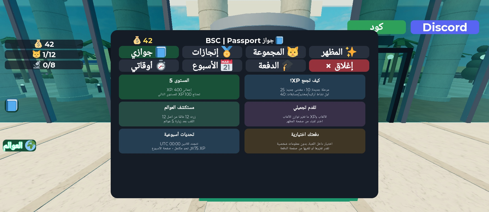
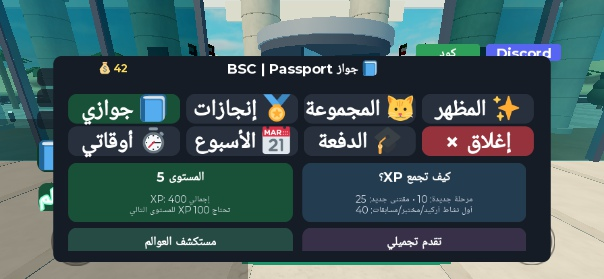

# BSC Passport v45 — التنفيذ والاختبار

2026-10-19، فرع `dev/v45` من v44، بتوجيه الإمبراطور وقرار المشرف بعد قبول v44 تطويريًا.
نسخة احتياطية قبل التعديل: `Desktop/KuwaitParkour/backup_before_v45_20261019`، تشمل بناء v44. لا نشر أو دمج.

## النتيجة

توسّع ملف اللاعب الحالي إلى جواز بسبع صفحات: جوازي، الإنجازات، المجموعة، المظهر، الأوقات، الأسبوع، والدفعة.
المتجر والمقتنيات والأوقات والألقاب السابقة باقية. زر الإغلاق في الخانة الثامنة لتجنب عناصر Roblox الأساسية على الهاتف.
الأزرار بارتفاع 44px، والنصوص تلتف داخل البطاقات، والمحتوى الطويل يُمرر داخل الصفحة.

| دليل يتحقق منه السيرفر | XP | منع التكرار |
|---|---:|---|
| مرحلة باركور جديدة | 10 | ختم لكل مرحلة 1–100؛ الإعادة لا تكرر XP |
| مقتنى جديد | 25 | ختم لكل قط أو عينة أو مقتنى ذهبي |
| أول نشاط مكتمل في الأركيد أو المختبر أو Game Show | 40 لكل فئة | ختم دائم لكل فئة |
| تحدٍ أسبوعي | 75 | ختم للأسبوع ومعرف التحدي؛ رفض الاستلام المبكر والمكرر |

المستوى = 1 + floor(XP/100). التقدم تجميلي، ومبالغ الكوينز والبحث الحالية لم تتغير.
أضيفت خمسة إنجازات وألقاب تجميلية: جولة أركيد، مختبر صحيح، حلقة مسابقات حتى نهايتها، زيارة خمسة عوالم، ومستوى 5.
تستخدم الألقاب نظام المظهر الحالي وتعرض شروط الحصول عليها. الدفعة اختيار اختياري من القائمة السابقة، ويمكن تغييرها
أو إلغاؤها دون معلومات شخصية أو نص حر أو تأثير على التقدم.

التحديات الأسبوعية: زيارة خمسة عوالم مختلفة، لمس ثلاث نقاط باركور مختلفة، وإكمال فئتين مختلفتين من الأنشطة الثلاثة.
التجدد الاثنين 00:00 UTC حسب ساعة السيرفر. تبقى أختام المكافآت القديمة محفوظة لمنع تكرار الاستلام.

## البيانات والثقة

- الحقل الجديد `passport` يحتوي `version, stamps, visits, weekly` مع قيم افتراضية للبيانات القديمة.
- يُحسب XP من الأختام المعروفة؛ لا يقبل السيرفر رقم XP من العميل. المراحل والمقتنيات القديمة تحصل على XP المقابل مرة واحدة.
- دمج UpdateAsync يجمع الأختام والزيارات ويحافظ على دليل الأسبوع الحالي والحقول القديمة. بقي منع الحفظ عند `loaded=false`.
- لا Remote لمنح XP؛ الدليل يأتي من نجاح الانتقال، ونقاط الباركور المعتبرة، ونتيجة النشاط على السيرفر.
- الأركيد يستبعد المغادرين، ويقبل المشاهد في الردهة بعد الإقصاء. المسابقات تشترط إجابة والبقاء داخل الاستوديو عند النهاية.
  قواعد المكافآت النقدية القديمة باقية.

## ما اختُبر فعليًا

| الفحص | النتيجة |
|---|---|
| قواعد Luau عبر Lune | نجاح الترحيل، منع تكرار XP، رفض الدليل المجهول والاستلام المبكر والمكرر، حد الاثنين قبل/بعد ثانية، دمج حفظ قديم وجديد، وعزل ملفين |
| مختبر Solo | طلب slide وإجابة صحيحة وtoken حقيقي: 40 XP وإنجاز؛ إعادة token رُفضت |
| أركيد Solo | جولة من النظام الحالي منحت 40 XP مرة واحدة؛ الجولات التالية لم تكرر الختم |
| Game Show | أكملت حلقة أصلية بست جولات عبر Prompts ومفاتيح E: 40 XP وإنجاز. حلقة غادرتها بعد إجابة لم تمنح XP أو إنجاز المسابقات |
| باركور ومقتنى | لمس المراحل 1 ثم 2 ثم 3: عشر نقاط لكل مرحلة؛ لمس القط c1: خمس وعشرون نقطة؛ المكافآت الأصلية تعمل |
| تحديات أسبوعية | استلام الثلاثة من أزرار الواجهة منح 75 لكل منها؛ الطلبات المكررة لم تزد XP |
| طلبات مزورة | رفض منح XP عشوائي، والاستلام دون دليل، واللقب المقفل، والدفعة غير المعروفة |
| ألقاب | تجهيز لقب المختبر، ورفض لقب مقفل؛ عند 400 XP فُتح مستوى 5 واختير لقبه من بطاقة المظهر الفعلية |
| دفعة عبر الهاتف | اختيار 2026 ثم 2025 ثم الإلغاء؛ بقي XP عند 400 والمرحلة عند 3 |
| هاتف | iPhone XR أفقي 801×413: الصفحات السبع تعمل، وكل TextFits ناجح. التمرير والاستلام والدفعة والإغلاق الفعلي نجحت |
| عميلان فعليان | سيرفر وعميلان من Studio: الأول أكمل مختبرًا وجولة = 80 XP؛ المغادر = 0 XP. ملفات مستقلة، وسبع صفحات لكل عميل، ورفض الطلبات المزورة |
| الوجهات الـ12 | وصل Travel إلى نقاط الظهور الصحيحة كلها، بمسافة أفقية 0؛ Course استأنف المرحلة 3 |
| إعادة دخول تجريبية | إعادة تحميل ملفات اختبار محلية ودمجها لم يكرر الأختام أو يغيّر البيانات القديمة؛ هذا ليس DataStore حيًا |

اختبار العميلين استخدم جولة مسرعة إلى ست ثوانٍ في السيرفر المؤقت فقط؛ مدد اللعبة المشحونة لم تتغير.
اختبارات Solo للأركيد والمسابقات استخدمت المدد الأصلية. نُزعت سكربتات الاختبار من Studio، وهي خارج src.
المخرجات في `v45/multiplayer-results.json`، ومصدر الاختبار في `tools/studio_tests/`.

مسار 400 XP المصوّر: 3 مراحل ×10 + مقتنى ×25 + 3 فئات نشاط ×40 + 3 تحديات ×75.
اللقطات تعرض ملف اختبار محليًا أُعيد تحميله بين جلسات Play، دون اتصال بحفظ حي.

## التحقق

- StyLua check ناجح؛ selene: صفر errors وصفر parse errors و26 تحذيرًا معروفًا، أقل بواحد من v44. التحذيرات تسبب exit1.
- بنوك الأسئلة نجحت: 48 سؤالًا في 8 بنوك، و80 سؤالًا لمركز التحديات، و5 مولدات ×400 سحب.
- المراجعة المستقلة رصدت منح XP عند مغادرة الأركيد والمسابقات؛ أُصلحت الحالتان، وأعيدت مراجعتهما واختبارهما في Studio.
- مقارنة XML: **Workspace كاملًا مطابق لبناء v44**، بما فيه Map والجزيرة. لا تغيير لهندسة الجامعة أو العوالم.
- العدد 66 مصدر سكربت، منها ثلاثة جديدة للجواز. بقي StreamingEnabled معطلًا.
- بداية Play نهائية: لا أخطاء جديدة من سكربتات اللعبة؛ بقيت رسائل DataStore غير المنشور وUIBlox والأصل 203785492 المعروفة.
- فحص الإغلاق رصد تداخل الزر القديم مع CoreGui في محاكي الهاتف؛ نُقل إلى صف الصفحات وأعيد الضغط عليه بنجاح.

أدوات الاختبار الرسمية: [StudioTestService](https://create.roblox.com/docs/reference/engine/classes/StudioTestService)
و[VirtualInput](https://create.roblox.com/docs/reference/engine/classes/VirtualInput).

## التسليم والحدود

البناء المحلي: `C:/Users/User/Desktop/KuwaitParkour/KuwaitParkour_v45.rbxlx`، 37,414,836 بايت.
SHA256: `4096ce6f5ac9b213c41a59c81d8e697627abee4851662875798f40f817f17eeb`.
Studio مفتوح في Edit بعنوان v43، بهندسة v44 وسكربتات v45، والمنفذ الافتراضي مستعاد. البناء الكبير خارج Git.

لم يُختبر حفظ دائم منشور أو هاتف حقيقي أو جلسة بشرية مطولة. اختبار العميلين محاكاة Studio.
يرسل التقرير للمشرف للمراجعة قبل المهمة التالية، ضمن توجيه الإمبراطور بالاستمرار.
